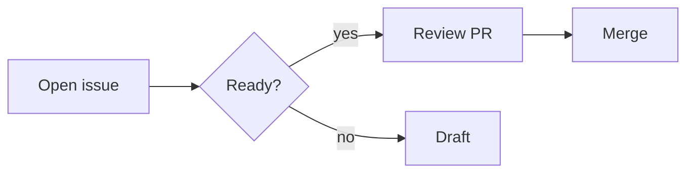

# OpenGH review and Markdown sandbox

Use this repository to test Markdown rendering, pull-request diffs, and review drafts.

The `examples/review-queue` directory contains deliberately small, dependency-free sample code and data for reviewing.

## 1. Task lists

Previously these appeared as ordinary bullets. Now completed tasks have a checked, green marker in rich mode; incomplete tasks have an empty, muted marker. Minimal mode keeps the checkboxes but removes the colors.

- [x] Implement Markdown styles
- [x] Review the Markdown changes
- [ ] Review the larger multi-file diff
- [ ] Ship the update
  - [x] Verify nested completed tasks
  - [ ] Verify nested incomplete tasks

Ordinary bullets should still look normal:

- This is not a checkbox
- Neither is this

## 2. Strikethrough

Previously deleted text lacked a visible strike. Now the crossed-out words should have a line through them.

~~This approach is obsolete.~~ Use the replacement instead.

Keep this text, ~~remove these words~~, and keep this too.

~~**Bold and deleted**~~ — **bold but not deleted**.

## 3. Small heading hierarchy

The next three headings now have explicit, distinct styles. The descriptions underneath explain what to look for.

#### Level four: underlined

This heading should be underlined rather than bold.

##### Level five: muted and bold

This heading should be bold with a muted color in rich mode.

###### Level six: muted and italic

This heading should be italic with a muted color in rich mode.

## 4. Rich versus minimal

Switch Markdown style in Settings between **rich** and **minimal**. The checkboxes, heading emphasis, and strikethrough should survive; the extra colors should disappear in minimal mode.

## 5. Editor improvements

These changes appear in the **comment composer**, not in this rendered README:

1. Open an issue or pull request and start writing a comment.
2. Paste the sample below into the composer.
3. Press **Ctrl+L** or click **show lines** to toggle line numbers.
4. Move the cursor: the **Ln / Col** indicator should update.
5. Switch to Preview and back: the draft and line-number preference should remain intact.

```markdown
First line of a draft.
Second line: move the cursor here.

- [x] Finished work
- [ ] Remaining work

~~Old wording~~ New wording.
```

## Review testing

See [the review walkthrough](docs/review-walkthrough.md) for line, range, and pending-review checks.

## Unchanged content for comparison

Normal text with **bold**, *italic*, and `inline code` should still look as before.

[OpenTUI](https://opentui.com) remains a normal link.

```typescript
const message = "Code highlighting is unchanged"
console.log(message)
```

---

# Extended GitHub rendering reference

This repository is a **synthetic, disposable test fixture**, not a real product or security incident. Existing examples above are intentionally preserved. GitHub web rendering is the baseline; terminal clients may deliberately render a subset. No private data, external secrets, paid services, or production deployments are needed.

## Navigation

[Headings](#headings) · [Formatting](#inline-formatting) · [Tables](#tables-and-alignment) · [Diagrams](#diagrams) · [Context differences](#context-dependent-features)

## Headings

# ATX heading 1
## ATX heading 2
### ATX heading 3
#### ATX heading 4
##### ATX heading 5
###### ATX heading 6

Setext heading 1
===============

Setext heading 2
---------------

### Duplicate heading
First anchor.
### Duplicate heading
Second anchor: [duplicate heading suffix](#duplicate-heading-1).

<a name="custom-anchor"></a>
[Custom HTML anchor](#custom-anchor)

## Inline formatting

Plain; **bold**; __also bold__; *italic*; _also italic_; ***bold italic***; **bold with _nested italic_**; ~~deleted~~; ~~**deleted bold**~~; <ins>inserted/underlined</ins>; <sub>subscript</sub>; <sup>superscript</sup>.

`inline code` and ``code containing `backticks` ``; <kbd>Ctrl</kbd> + <kbd>K</kbd>; <samp>sample output</samp>; <abbr title="GitHub Flavored Markdown">GFM</abbr>.

Escapes: \*literal asterisks\*, \_underscores\_, \[brackets\], \# hash, \\ slash, &amp; &lt; &gt; &copy; &#9731;.

Emoji: :smile: :tada: :warning: :+1: :shipit: — Unicode: 🧪 🚀 café 日本語 العربية é.

A soft
line break.

A hard break with two trailing spaces.  
Next line after hard break.

An explicit HTML break.<br>Next HTML line.

<!-- This comment must remain invisible in rendered output. -->

## Lists and quotes

- Unordered item
  - Nested item with **emphasis**
    1. Nested ordered item
    2. Another item
- Second item

1. Ordered item
2. Item with multiple paragraphs

   Continuation paragraph belonging to item two.

   ```text
   code nested in a list
   ```

3. Final item

- [x] Completed task
- [ ] Incomplete task
  - [x] Nested completed task
  - [ ] Nested incomplete task

> A blockquote with **bold** and a [link](https://github.com).
>
> > Nested quotation.
>
> - A quoted list

> [!NOTE]
> Helpful reference information.

> [!TIP]
> A suggested shortcut.

> [!IMPORTANT]
> Essential information for the fixture.

> [!WARNING]
> Expected failing checks are intentional.

> [!CAUTION]
> Do not use this sandbox with production credentials.

## Links and references

[External link](https://github.com "GitHub title") · <https://github.com> · https://github.com · <sandbox@example.invalid> · [reference-style link][github-reference] · [relative image file](assets/showcase.svg) · [relative document](fixtures/reference.md).

[github-reference]: https://github.com "Reference definition title"

Contextual references: @leohenon, #1, leohenon/opengh-sandbox#2. Mentions and issue autolinks vary by README/comment context; see the new issue bodies for actual linked references.

## Tables and alignment

| Left aligned | Center aligned | Right aligned |
| :--- | :---: | ---: |
| **bold** | `code` | 123 |
| escaped \| pipe | [link](https://github.com) | -4.50 |
| ~~deleted~~ | 🧪 | 0 |
| empty next cell | | 999999 |

## Code blocks

```typescript
interface Fixture { name: string; enabled: boolean }
const fixture: Fixture = { name: "sandbox", enabled: true };
console.log(fixture);
```

```diff
- const legacy = true;
+ const legacy = false;
```

```json
{"name":"sandbox","nested":{"enabled":true},"items":[1,null,"three"]}
```

```bash
printf '%s\n' 'No credentials required'
```

````markdown
```text
A fenced block inside a longer fence.
```
````

~~~text
Tilde-delimited fence.
~~~

    Indented code block
    with a second line

```
Unlabelled code block.
```

Inline color tokens (supported in some issue/PR contexts): `#0969DA`, `rgb(9, 105, 218)`, `hsl(212, 92%, 45%)`.

## Images and supported HTML


[](https://github.com/leohenon/opengh-sandbox)

<picture>
  <source media="(prefers-color-scheme: dark)" srcset="assets/showcase.svg">
  <source media="(prefers-color-scheme: light)" srcset="assets/showcase.svg">
  
</picture>

<p align="center"><strong>Centered HTML paragraph</strong><br><em>HTML emphasis</em></p>

<details>
<summary>Collapsed disclosure with Markdown content</summary>

### Inside a disclosure

- [x] Nested task
- [ ] Another task

```text
Disclosure code block
```

</details>

<details open>
<summary>Initially open disclosure</summary>

A second disclosure with a [link](#tables-and-alignment).

</details>

Horizontal rules:

---

***

___

## Footnotes

An ordinary footnote[^short] and a multi-paragraph footnote[^long]. Reuse the first[^short].

[^short]: A short footnote with **emphasis**.
[^long]: First footnote paragraph.

    Second paragraph with `inline code`.

## Mathematics

Inline math: $a^2 + b^2 = c^2$. Alternative inline math: $`E = mc^2`$.

$$
\sum_{i=1}^{n} i = \frac{n(n+1)}{2}
$$

```math
\begin{pmatrix}1 & 0 \\ 0 & 1\end{pmatrix}
```

## Diagrams



```geojson
{"type":"FeatureCollection","features":[{"type":"Feature","properties":{"name":"Synthetic map marker"},"geometry":{"type":"Point","coordinates":[2.3522,48.8566]}}]}
```

```topojson
{"type":"Topology","objects":{"fixture":{"type":"GeometryCollection","geometries":[{"type":"Point","coordinates":[2,49],"properties":{"name":"Reference point"}}]}},"arcs":[]}
```

```stl
solid fixture
  facet normal 0 0 1
    outer loop
      vertex 0 0 0
      vertex 1 0 0
      vertex 0 1 0
    endloop
  endfacet
endsolid fixture
```

## Context-dependent features

This is a broad catalogue of GitHub's documented Markdown families, **not a promise that every HTML tag or embedded format is accepted everywhere**. GitHub sanitizes HTML; scripts, iframes, arbitrary CSS, forms, and executable embeds are intentionally not fixtures.

- Issue/PR references, commit autolinks, mentions, task progress, color swatches, and closing keywords should also be tested in issue/PR bodies and comments.
- Suggestions and diff line anchors require PR review comments; they are not applied from this README.
- Video/audio attachment players require actual GitHub-hosted uploads. This fixture does not substitute a fake URL or depend on private uploaded media.
- File permalinks/code excerpts depend on GitHub context and visibility. Relative links/images must resolve from the default branch.
- Footnotes, math, diagrams, HTML, image themes, and disclosures may have different support in GitHub surfaces and OpenGH. A fallback is not necessarily a bug.
- Syntax highlighting is language-dependent; the code fences above exercise representative token families rather than every language alias.

Authoritative baseline: [basic writing](https://docs.github.com/en/get-started/writing-on-github/basic-writing-and-formatting-syntax), [advanced formatting](https://docs.github.com/en/get-started/writing-on-github/working-with-advanced-formatting), and the [GFM specification](https://github.github.com/gfm/).
